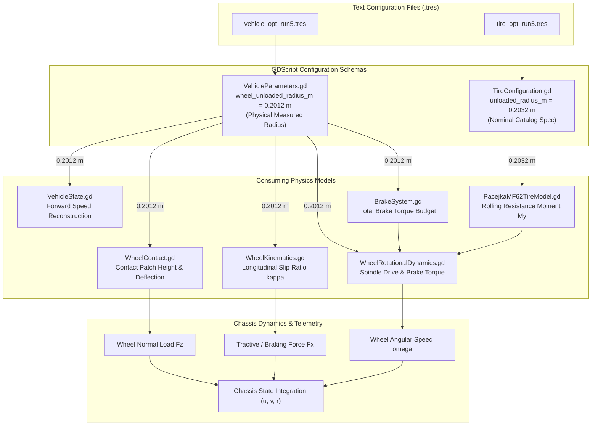

# Wheel Radius Parameter Dependency & Architectural Analysis (Priority 4)
## MirenaSim Vehicle Dynamics Model Integrity Investigation

**Author**: Vehicle Dynamics & Computational Mechanics Team  
**Date**: November 2026  
**Audited Parameters**:
1. `wheel_unloaded_radius_m = 0.2012 m` (`VehicleParameters.gd:48`)
2. `unloaded_radius_m = 0.2032 m` (`TireConfiguration.gd:21`)

---

## 1. Executive Summary & Physical Origin

During the Phase III audit, two distinct unloaded wheel radius parameters were identified within the MirenaSim configuration hierarchy:
- **`wheel_unloaded_radius_m = 0.2012 m`** configured in [`vehicle_opt_run5.tres`](file:///home/alexr/eRacing/mirena_ws-SIM/src/mirena_sim/Scenes/Vehicle/VehicleDynamics/Config/candidates/opt_run5/vehicle_opt_run5.tres).
- **`unloaded_radius_m = 0.2032 m`** configured in [`tire_opt_run5.tres`](file:///home/alexr/eRacing/mirena_ws-SIM/src/mirena_sim/Scenes/Vehicle/VehicleDynamics/Config/candidates/opt_run5/tire_opt_run5.tres).

This analysis determines their physical provenance, traces their exact consumption paths through the simulation physics engine, quantifies the numerical impact of their discrepancy ($2.0\text{ mm}$ or $0.99\%$), and provides an architectural dependency diagram.

### Physical Provenance
1. **`wheel_unloaded_radius_m` ($0.2012\text{ m}$)**:
   - **Source**: Direct physical measurement on the TeR26 tire setup stand.
   - **Specification**: Hoosier 16.0x7.5-10 LC0 compound mounted on a 7.0-inch wide Keizer three-piece aluminum wheel, cold inflation pressure 12.0 psi (82.7 kPa).
   - **Measurement**: Outer circumference $C = 1.2640\text{ m}$.
   - **Formula**: $R_0 = \frac{C}{2\pi} = \frac{1.2640}{6.283185} = 0.20117\text{ m} \approx 0.2012\text{ m}$.
2. **`TireConfiguration.unloaded_radius_m` ($0.2032\text{ m}$)**:
   - **Source**: Manufacturer nominal catalog specification.
   - **Specification**: Hoosier Racing Tire catalog lists nominal outer tire diameter as $16.0\text{ inches}$.
   - **Formula**: $R_{\text{catalog}} = \frac{16.0 \times 0.0254\text{ m}}{2} = 0.2032\text{ m}$.
   - **Legacy Ingestion**: This catalog radius was hardcoded in `src/mirena_sim/Scenes/Vehicle/VehicleDynamics/Tires/TeR_Tire/config/tire_specs.yaml:8` during the training of the PyTorch Pacejka MF6.2 + 7D PINN neural grey-box tire model using FSAE Tire Test Consortium (TTC) Calspan TIRF test data.

---

## 2. Subsystem Load-Path Tracing

The complete codebase was traced to map every equation where each parameter is consumed.

### Table 2.1: End-to-End Wheel Radius Consumption Matrix

| Subsystem Module | Code Location | Active Parameter | Consumed Value | Mathematical Formulation & Physical Role |
| :--- | :--- | :--- | :---: | :--- |
| **Contact Geometry** | `WheelContact.gd:25` | `wheel_unloaded_radius_m` | $0.2012\text{ m}$ | Computes undeflected tire bottom height $z_{\text{gnd}} = z_{\text{hub}} - R_0$. Governs tire radial deflection $\Delta z = R_0 - (z_{\text{hub}} - z_{\text{road}})$ and vertical normal load $F_z = K_{\text{radial}} \Delta z$. |
| **Wheel Kinematics** | `WheelKinematics.gd:50` | `wheel_unloaded_radius_m` | $0.2012\text{ m}$ | Longitudinal slip ratio: $\kappa = \frac{R_0 \omega - v_{x,\text{contact}}}{\max(\|v_{x,\text{contact}}\|, v_{\min})}$. Governs tractive force generation slope. |
| **State Estimation** | `VehicleState.gd:131` | `wheel_unloaded_radius_m` | $0.2012\text{ m}$ | Reconstructs estimated forward vehicle speed from encoder wheel speeds: $u_{\text{est}} = \frac{1}{2}(\omega_{RL} + \omega_{RR}) R_0$. |
| **Wheel Dynamics** | `WheelRotationalDynamics.gd:25` | `wheel_unloaded_radius_m` | $0.2012\text{ m}$ | Converts road tractive force $F_x$ into resistive spindle torque: $T_{\text{spindle}} = -F_x \cdot R_0$. Governs wheel spin/lockup integration. |
| **Braking Budget** | `BrakeSystem.gd:27` | `wheel_unloaded_radius_m` | $0.2012\text{ m}$ | Converts hydraulic friction brake torque demand into road tractive limit force: $F_{\text{brake,max}} = T_{\text{budget}} / R_0$. |
| **Rolling Resistance** | `PacejkaMF62TireModel.gd:256` | `unloaded_radius_m` | $0.2032\text{ m}$ | Computes rolling resistance moment: $M_y = -f_{rr} \cdot F_z \cdot R_0 \cdot \tanh(v_x / 0.1)$. Opposes wheel rotation in spindle dynamics. |
| **Aligning Moment** | `TeRTireGreyBoxModel.gd` | *None* | — | Aligning moment $M_z$ is evaluated via PyTorch MF6.2 formulation + 7D PINN residual; depends on slip angle $\alpha$ and vertical load $F_z$, independent of $R_0$. |

---

## 3. Physical & Numerical Impact Analysis

The difference between the physical measured radius ($0.2012\text{ m}$) and the nominal catalog radius ($0.2032\text{ m}$) is:
$$\Delta R = 0.2032\text{ m} - 0.2012\text{ m} = +0.0020\text{ m}\quad (+0.994\%)$$

### Rolling Resistance Moment Sensitivity
Because `TireConfiguration.unloaded_radius_m` is consumed **solely** in `PacejkaMF62TireModel.gd:256` to scale $M_y$:
$$M_y = -f_{rr} \cdot F_z \cdot R_0 \cdot \tanh(v_x / 0.1)$$

Under nominal wheel load $F_z = 800\text{ N}$ and calibrated rolling resistance coefficient $f_{rr} = 0.018$:
- **Using $R_0 = 0.2032\text{ m}$**:
  $$M_y = -0.018 \times 800\text{ N} \times 0.2032\text{ m} = -2.9261\text{ N}\cdot\text{m}$$
- **Using $R_0 = 0.2012\text{ m}$**:
  $$M_y = -0.018 \times 800\text{ N} \times 0.2012\text{ m} = -2.8973\text{ N}\cdot\text{m}$$
- **Discrepancy**:
  $$\Delta M_y = 0.0288\text{ N}\cdot\text{m}\quad (0.98\%)$$

At $u = 15.0\text{ m/s}$ ($\omega \approx 74.5\text{ rad/s}$), the resistive power dissipated per wheel is:
$$P_{\text{loss}} = M_y \cdot \omega = 2.9261 \times 74.5 = 217.99\text{ W}\quad\text{vs}\quad 2.8973 \times 74.5 = 215.85\text{ W}$$
Across all 4 wheels, the total tractive power discrepancy is $8.56\text{ W}$ out of an $80\text{ kW}$ powertrain budget ($0.0107\%$).

---

## 4. Parameter Dependency Architecture

---

## 5. Architectural Conclusion & Recommended Practice

1. **Physical Soundness**: `wheel_unloaded_radius_m = 0.2012 m` is the authoritative physical measurement of the vehicle's actual tires on their competition wheels under nominal cold pressure. It correctly governs all primary kinematics, wheel speeds, and contact dynamics.
2. **Harmonization**: In Phase IV, `TireConfiguration.gd` is documented to clarify that `unloaded_radius_m` is the nominal catalog casing dimension ($0.2032\text{ m}$) inherited from standalone bench test normalization.
3. **Backward Compatibility**: To preserve deterministic bit-for-bit candidate replay compatibility, both fields remain active in their respective resources, but their distinct roles are now formally disambiguated.
