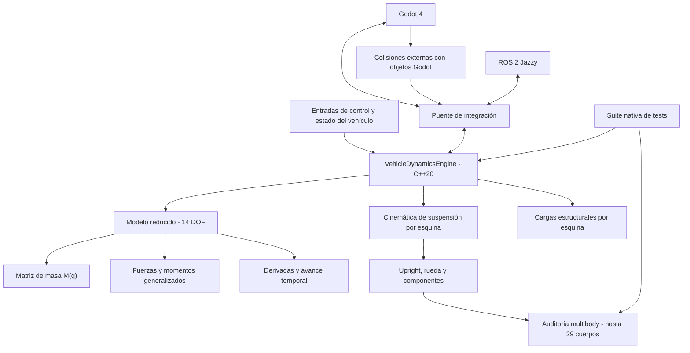

# TeR26 · Mirena Dynamics

<p align="center">
  <strong>Modelo dinámico de vehículo · C++20 · Godot 4 · ROS 2</strong>
</p>

<p align="center">
  
  
  
  
  
</p>

> **TeR26** es el modelo de dinámica vehicular integrado en **Mirena Dynamics**. Su núcleo nativo resuelve la dinámica mediante una formulación reducida de 14 grados de libertad (DOF) y permite contrastar esa formulación con una descomposición explícita en cuerpos rígidos. Godot proporciona el entorno de simulación y la interacción con objetos externos; ROS 2 forma parte de la integración del sistema.

---

## Contenido

- [1. Visión general](#1-visión-general)
- [2. Arquitectura](#2-arquitectura)
- [3. Modelo dinámico: 14 DOF](#3-modelo-dinámico-14-dof)
- [4. Suspensión y descomposición multibody](#4-suspensión-y-descomposición-multibody)
- [5. Energía, gravedad y formulación generalizada](#5-energía-gravedad-y-formulación-generalizada)
- [6. Contacto neumático-suelo y colisiones externas](#6-contacto-neumático-suelo-y-colisiones-externas)
- [7. Cálculo de cargas estructurales](#7-cálculo-de-cargas-estructurales)
- [8. Integración con Godot y ROS 2](#8-integración-con-godot-y-ros-2)
- [9. Auditoría de equivalencia L13](#9-auditoría-de-equivalencia-l13)
- [10. Cambios incorporados](#10-cambios-incorporados)
- [11. Tests y estado de validación](#11-tests-y-estado-de-validación)
- [12. Estructura relevante del proyecto](#12-estructura-relevante-del-proyecto)
- [13. Compilación y ejecución](#13-compilación-y-ejecución)
- [14. Limitaciones y trabajo pendiente](#14-limitaciones-y-trabajo-pendiente)
- [15. Criterios de contribución](#15-criterios-de-contribución)

---

## 1. Visión general

El objetivo del modelo es representar la respuesta dinámica del vehículo con suficiente detalle para estudiar su comportamiento, evaluar cambios de parámetros y generar magnitudes útiles para la integración con el simulador y el análisis estructural.

El proyecto separa dos niveles de representación:

| Nivel | Representación | Uso principal |
|---|---|---|
| **Modelo reducido** | 14 grados de libertad generalizados | Integración temporal eficiente de la dinámica del vehículo |
| **Modelo de componentes** | Cuerpos rígidos explícitos | Auditoría de energía y momento; representación de las inercias de los componentes de suspensión |

La formulación reducida concentra el comportamiento de los conjuntos en una matriz de masa generalizada. La representación por componentes permite descomponer ese comportamiento en cuerpos físicos y comprobar que ambas descripciones son coherentes en los estados evaluados.

### Principios de diseño

- **Separación entre dinámica e integración:** el núcleo de dinámica está implementado en C++20; Godot actúa como entorno de simulación e integración.
- **Coherencia mecánica:** las contribuciones de masa, inercia, gravedad y movimiento de los componentes deben estar contabilizadas de forma consistente.
- **Trazabilidad:** los nuevos cálculos deben poder contrastarse mediante tests reproducibles.
- **Validación por niveles:** una equivalencia algebraica no sustituye a la validación física frente a datos experimentales o referencias independientes.

---

## 2. Arquitectura



### Responsabilidades principales

| Elemento | Responsabilidad |
|---|---|
| `VehicleDynamicsEngine` | Parámetros, evaluación de derivadas, matriz de masa, dinámica y cálculo de resultados por paso |
| `SuspensionKinematicsSolver` | Cinemática de cada esquina y magnitudes geométricas utilizadas por la dinámica |
| `component_multibody` | Ensamblaje de las contribuciones dinámicas de los componentes de suspensión |
| `compute_component_equivalence_report` | Comparación entre la formulación reducida y la suma de cuerpos explícitos |
| `compute_ansys_corner_structural_loads` | Obtención de cargas estructurales por esquina a partir del estado dinámico y de las cargas de contacto |
| `vehicle_collision_bridge.gd` | Comunicación de colisiones externas entre Godot y el puente nativo |
| `test_ter26_suite.cpp` | Tests nativos del motor, incluida la auditoría L13 |

---

## 3. Modelo dinámico: 14 DOF

El núcleo utiliza un vector de velocidades generalizadas de 14 componentes:

\[
\boldsymbol{\nu} =
\begin{bmatrix}
\mathbf{v}_b \\
\boldsymbol{\omega}_b \\
\dot{q}_{s,FL} \\
\dot{q}_{s,FR} \\
\dot{q}_{s,RL} \\
\dot{q}_{s,RR} \\
\omega_{FL} \\
\omega_{FR} \\
\omega_{RL} \\
\omega_{RR}
\end{bmatrix}
\in \mathbb{R}^{14}
\]

Donde:

| Coordenadas | Número | Descripción |
|---|---:|---|
| \(\mathbf{v}_b\) | 3 | Velocidad lineal del chasis expresada en el marco del cuerpo \(F_B\) |
| \(\boldsymbol{\omega}_b\) | 3 | Velocidad angular del chasis expresada en \(F_B\) |
| \(\dot q_{s,i}\) | 4 | Velocidad de recorrido de suspensión de FL, FR, RL y RR |
| \(\omega_i\) | 4 | Velocidad de giro de cada rueda |
| **Total** | **14** | **14 velocidades generalizadas** |

Por tanto, el vector agrupa:

- **6 componentes de movimiento del chasis:** traslación y rotación.
- **4 coordenadas de suspensión:** una por cada esquina.
- **4 coordenadas de giro de rueda:** una por cada rueda.

La matriz de masa generalizada es de dimensión:

\[
\mathbf{M}(q) \in \mathbb{R}^{14\times14}
\]

La energía cinética asociada a la formulación reducida se calcula como:

\[
T_{\mathrm{red}} =
\frac{1}{2}\boldsymbol{\nu}^{T}
\mathbf{M}(q)\boldsymbol{\nu}
\]

Esta expresión es una de las referencias utilizadas por la auditoría de equivalencia multibody.

> **Nota sobre el alcance:** los 14 DOF describen las coordenadas dinámicas generalizadas del modelo reducido. No significan que el vehículo esté compuesto físicamente por solo 14 piezas ni que cada pieza tenga necesariamente un DOF independiente.

---

## 4. Suspensión y descomposición multibody

La cinemática se evalúa por esquina. Para cada una se obtienen, entre otras magnitudes utilizadas por el motor:

- Posición del centro de rueda.
- Orientación del upright.
- Eje del spindle.
- Derivada de la posición del centro de rueda respecto al recorrido de suspensión.
- Variación de la velocidad angular del upright con el recorrido.
- Deflexión de muelle.
- Magnitudes geométricas necesarias para las fuerzas y momentos generalizados.

### 4.1 Modelo reducido

En el modelo reducido, las masas e inercias de los elementos que no poseen coordenadas independientes se reflejan en las contribuciones de la matriz de masa y de los términos dinámicos generalizados.

### 4.2 Modelo explícito por cuerpos

La auditoría puede construir una descomposición con los siguientes elementos:

| Elemento | Cantidad |
|---|---:|
| Chasis | 1 |
| Uprights | 4 |
| Ruedas | 4 |
| Componentes de suspensión adicionales | 5 por esquina = 20 |
| **Total con inercias de componentes activadas** | **29 cuerpos** |

La cuenta es:

\[
N_{\mathrm{cuerpos}} =
1 + 4(1_{\mathrm{upright}} + 1_{\mathrm{rueda}} + 5_{\mathrm{componentes}})
= 29
\]

Cuando `include_component_inertias` está desactivado, la descomposición del informe contiene 9 elementos: el chasis, los cuatro uprights y las cuatro ruedas.

En el informe L13, la masa no suspendida se concentra en el centro de rueda del upright y la rueda explícita aporta su inercia rotacional; la inercia reflejada del tren motriz se suma por separado a la energía cinética total de la auditoría.

### 4.3 Activación de inercias de componentes

La opción relevante es:

```cpp
params.component_inertias.include_component_inertias = true;
```

Cuando está activada, el motor ensambla las contribuciones de los elementos de suspensión y acumula sus términos de energía potencial y fuerzas generalizadas gravitatorias, además de incorporarlos a la representación explícita utilizada por el informe.

---

## 5. Energía, gravedad y formulación generalizada

Uno de los cambios centrales incorporados consiste en contabilizar de forma explícita las contribuciones gravitatorias de los componentes de suspensión.

### 5.1 Gravedad en el marco global

En el código nativo, el vector de gravedad global se define con el eje Z positivo hacia arriba:

\[
\mathbf{g}_w =
\begin{bmatrix}
0\\
0\\
-g
\end{bmatrix}
\]

La contribución de cada componente se transforma y proyecta sobre las coordenadas generalizadas durante el ensamblaje dinámico.

### 5.2 Fuerzas generalizadas gravitatorias

Para cada esquina, el motor acumula un vector de contribuciones:

\[
\mathbf{Q}_{\mathrm{comp},i}\in\mathbb{R}^{14}
\]

Y lo incorpora al vector generalizado total:

\[
\mathbf{Q}\leftarrow
\mathbf{Q}+\sum_{i=1}^{4}\mathbf{Q}_{\mathrm{comp},i}
\]

La implementación utiliza `assemble_corner_component_dynamics(...)` para obtener las contribuciones de cada esquina, incluyendo el estado del chasis, la cinemática local, la gravedad y el recorrido de suspensión.

### 5.3 Energía potencial gravitatoria

El balance energético del motor incluye:

\[
V =
V_{\mathrm{chasis}}+
V_{\mathrm{no\ suspendido}}+
V_{\mathrm{ARB}}+
V_{\mathrm{componentes}}
\]

La posición del centro de rueda se calcula respecto al centro de gravedad del chasis mediante la corrección de altura `h_cg_m`:

\[
\mathbf{p}_{wc,w} =
\mathbf{p}_{b,w}+
\mathbf{R}_{wb}
\left(
\mathbf{r}_{wc,b}-
\begin{bmatrix}
0\\
0\\
h_{cg}
\end{bmatrix}
\right)
\]

La energía potencial de los componentes se acumula en `V_comp_grav_J` y se añade al balance `V_pot`.

**Resultado práctico:** las contribuciones gravitatorias de las masas de los elementos de suspensión dejan de quedar fuera del vector generalizado y del balance de energía potencial cuando se activa el modelo de inercias de componentes.

---

## 6. Contacto neumático-suelo y colisiones externas

El proyecto distingue dos mecanismos de interacción diferentes.

### 6.1 Contacto rueda-suelo

El comentario de integración del puente de colisiones especifica que el contacto normal de las ruedas con el terreno se gestiona mediante los cuatro raycasts HPITM del modelo de neumático. Por ello, las superficies de pista y suelo identificadas por el puente no se tratan como colisiones externas genéricas del chasis.

### 6.2 Colisiones externas de Godot

Para impactos con objetos externos —por ejemplo, conos u otros cuerpos rígidos—, Godot utiliza `Ter26VehicleCollisionBridge` para invocar el método nativo:

```text
apply_collision_impulse_godot
```

El esquema físico empleado por el puente nativo se basa en el impulso y el cambio de momento:

\[
\Delta\mathbf{v} =
\mathbf{M}(q)^{-1}
\mathbf{J}_{c}(q)^T\boldsymbol{\Lambda}
\]

Donde \(\mathbf{J}_c\) representa el Jacobiano de contacto y \(\boldsymbol{\Lambda}\) el impulso aplicado.

El puente también devuelve el impulso correspondiente al objeto externo para aplicar la reacción opuesta cuando el objeto es un `RigidBody3D`.

### 6.3 Corrección de aplicación del impulso en Godot

La implementación anterior combinaba `apply_central_impulse(...)` con una modificación adicional de `linear_velocity`. Eso podía contabilizar dos veces el mismo impulso.

La implementación actual actualiza la velocidad lineal una sola vez mediante:

```gdscript
rb2.linear_velocity += total_imp / maxf(0.05, rb2.mass)
```

La razón documentada en el código es que el getter de `linear_velocity` puede permanecer desincronizado dentro del mismo frame después de modificar directamente el estado del servidor de física con `apply_central_impulse`. La asignación de velocidad permite que el estado posterior a la colisión sea observable en ese mismo frame.

También se ha extraído el impulso vertical auxiliar aplicado a los conos a una constante:

```gdscript
const CONE_LIFT_IMPULSE_NS := 0.35
```

> Este término auxiliar pertenece al comportamiento de interacción con los conos. No debe confundirse con un parámetro de la dinámica general del vehículo ni con una fuerza continua.

---

## 7. Cálculo de cargas estructurales

El motor dispone de un cálculo de cargas estructurales por esquina orientado a obtener las acciones que se pueden transferir a un análisis estructural externo, como ANSYS.

La función se apoya en:

- Geometría y cinemática de suspensión de cada esquina.
- Fuerzas y momentos del neumático.
- Fuerzas del sistema antibalanceo (ARB).
- Par de freno y reacción de par del upright.
- Aceleración lineal y angular del chasis.
- Velocidad y aceleración del recorrido de suspensión.
- Gravedad expresada en el marco local.

### 7.1 Aceleración del chasis en el marco del cuerpo

La derivada de la velocidad lineal expresada en un marco rotatorio no es directamente la aceleración física expresada en ese marco. Por ello, se incorpora el término convectivo:

\[
\mathbf{a}_{b} =
\left(\frac{d\mathbf{v}_b}{dt}\right)_{F_B}
+
\boldsymbol{\omega}_b\times\mathbf{v}_b
\]

En el código:

```cpp
const Vec3 a_chassis_b = step_res.generalized_accel.segment<3>(0)
                       + state.omega_b.cross(state.v_b);
```

### 7.2 Momento del neumático en el centro de rueda

El momento de contacto se traslada al centro de rueda mediante:

\[
\mathbf{M}_{wc} =
\mathbf{M}_{patch}+
\mathbf{r}_{wc\rightarrow cp}\times\mathbf{F}_{tire}
\]

El par de freno se pasa mediante los argumentos específicos de la función de cargas estructurales, en lugar de volver a sumarlo dentro de `M_tire_at_wc_b`. Esto evita contabilizar dos veces el mismo término.

### 7.3 Inercia del upright

La matriz de inercia del upright se rota a la orientación actual del componente:

\[
\mathbf{I}_{u,b} =
\mathbf{R}_{u}\mathbf{I}_{u}\mathbf{R}_{u}^{T}
\]

La función recibe además el solver de cinemática de la esquina, el ángulo de dirección, la fuerza del ARB y las magnitudes cinemáticas necesarias para reconstruir las cargas.

> **Alcance de validación:** que el motor calcule y exporte estas cargas no demuestra por sí solo que el mallado, las condiciones de contorno o los resultados de un modelo FEM sean correctos. La correlación con el modelo estructural debe verificarse por separado.

---

## 8. Integración con Godot y ROS 2

### Godot

Godot 4.x proporciona el escenario de simulación, los objetos físicos externos y los nodos que conectan el vehículo con el motor nativo. El puente `vehicle_collision_bridge.gd` gestiona los impactos discretos que no pertenecen al contacto normal rueda-suelo.

### ROS 2

El proyecto se trabaja con **ROS 2 Jazzy**. La integración ROS se utiliza para conectar el simulador con el ecosistema de comunicación y control del vehículo.

La disponibilidad de ROS 2 depende de que el entorno tenga cargados los espacios de instalación correspondientes. En una terminal Linux habitual:

```bash
source /opt/ros/jazzy/setup.bash
source install/setup.bash
```

El segundo comando debe ejecutarse desde el workspace ROS que contiene el directorio `install/` correspondiente.

### Entorno de desarrollo conocido

| Componente | Entorno utilizado |
|---|---|
| Lenguaje nativo | C++20 |
| Motor de simulación | Godot 4.7.1 |
| Middleware | ROS 2 Jazzy |
| Sistema de compilación nativo | CMake |
| Sistema operativo de desarrollo | Linux |

Las versiones anteriores describen el entorno de trabajo utilizado durante el desarrollo; no constituyen por sí mismas una matriz completa de compatibilidad para otros sistemas operativos.

---

## 9. Auditoría de equivalencia L13

La prueba **L13 — 29-Body Component Decomposition vs Reduced 14-DOF Equivalence (T, V, P, L)** es una de las incorporaciones más importantes.

Su objetivo es comparar dos formas de describir el mismo estado del vehículo:

1. La suma de las contribuciones de los cuerpos explícitos.
2. La formulación reducida a través de la matriz de masa generalizada y las expresiones de energía potencial.

### 9.1 Magnitudes comparadas

| Magnitud | Modelo de cuerpos | Modelo reducido |
|---|---|---|
| Energía cinética \(T\) | Suma de energías de cuerpos + inercia reflejada del drivetrain | \(\frac12\nu^T M(q)\nu\) |
| Energía potencial \(V\) | Suma de potencial gravitatorio de cuerpos | Balance reducido de chasis, masas no suspendidas y componentes |
| Momento lineal \(P\) | Suma de momentos lineales de los cuerpos | Primeras 3 componentes de \(M(q)\nu\) |
| Momento angular \(L\) | Suma de momento orbital y espín | Componentes 4 a 6 de \(M(q)\nu\) |

Para el momento angular de cada cuerpo se incluye el momento orbital respecto al centro de gravedad de referencia y el momento de espín:

\[
\mathbf{L}_b =
\mathbf{r}_b\times(m_b\mathbf{v}_b)
+
\mathbf{I}_b\boldsymbol{\omega}_b
\]

### 9.2 Estado de prueba

El test configura un estado deliberadamente no trivial:

- Orientación del chasis con roll, pitch y yaw.
- Velocidades lineales y angulares distintas de cero.
- Recorridos y velocidades de suspensión diferentes por esquina.
- Velocidades de giro de rueda.
- Ángulo de dirección distinto de cero.
- Inercias de componentes activadas.

La configuración evita limitar la comprobación a un estado estático o perfectamente simétrico.

### 9.3 Tolerancias de la prueba

El test utiliza:

\[
\epsilon_T =
10^{-10}\max(1,|T_{red}|)
\]

\[
\epsilon_P =
10^{-10}\max(1,\|P_{red}\|),\qquad
\epsilon_L =
10^{-10}\max(1,\|L_{red}\|)
\]

Y para la energía potencial:

\[
|V_{cuerpos}-V_{red}| < 10^{-9}\;\mathrm{J}
\]

### 9.4 Resultado registrado

En la ejecución comunicada para L13 se obtuvo:

| Magnitud | Resultado registrado |
|---|---:|
| Cuerpos explícitos | 29 |
| Energía cinética en ambos modelos | 32 917,412979 J |
| Diferencia de energía cinética | 0 J |
| Diferencia de energía potencial | 0 J |
| Diferencia de momento lineal | 0 |
| Diferencia de momento angular | 0 |

<details>
<summary><strong>Qué demuestra y qué no demuestra L13</strong></summary>

**Sí demuestra:** para el estado de prueba y las convenciones implementadas, la descomposición explícita y la formulación reducida ofrecen los mismos valores de energía y momento dentro de las tolerancias definidas.

**No demuestra por sí sola:**

- Que todos los Jacobianos cinemáticos sean físicamente exactos.
- Que los parámetros de masa e inercia correspondan a la geometría real.
- Que el modelo de neumático reproduzca datos experimentales.
- Que la integración temporal sea convergente para cualquier escenario.
- Que las cargas estructurales estén correlacionadas con ensayos o con un FEM independiente.
- Que la equivalencia se mantenga automáticamente en cualquier configuración o estado no cubierto por los tests.

La equivalencia algebraica es una condición importante de consistencia, pero no sustituye a la validación física.

</details>

---

## 10. Cambios incorporados

Esta sección documenta los cambios recientes que se han revisado en el diff del repositorio.

### 10.1 Gravedad de los componentes de suspensión

**Archivos:**

- `Scenes/Vehicle/Native/src/core/vehicle_dynamics_engine.cpp`
- `Scenes/Vehicle/Native/src/core/component_multibody.cpp`

Cambios:

- Se crea el vector de gravedad global para el ensamblaje de componentes.
- Se acumulan las contribuciones gravitatorias generalizadas de cada esquina.
- Se acumula la energía potencial de los componentes.
- Las contribuciones se suman a `Q` y `V_pot` cuando las inercias de componentes están activadas.
- La posición de los centros de rueda en el cálculo de potencial utiliza la referencia de altura del centro de gravedad `h_cg_m`.

### 10.2 Nueva API de auditoría multibody

**Archivos:**

- `Scenes/Vehicle/Native/include/ter26/multibody/vehicle_dynamics_engine.hpp`
- `Scenes/Vehicle/Native/src/core/vehicle_dynamics_engine.cpp`

Nueva interfaz:

```cpp
ComponentMultibodyEquivalenceReport compute_component_equivalence_report(
    const VehicleState& state,
    const ControlInputs& controls,
    const std::array<GroundContactQuery, 4>& ground) const;
```

La función construye la lista de cuerpos explícitos, calcula las magnitudes energéticas y de momento, obtiene las magnitudes reducidas y devuelve sus diferencias absolutas o sus normas.

### 10.3 Test L13

**Archivo:**

- `Scenes/Vehicle/Native/tests/test_ter26_suite.cpp`

Se añade `test_l13_component_equivalence_audit()` y se registra en `main()` después de L12.

La prueba verifica:

- Construcción de 29 cuerpos.
- Equivalencia de energía cinética.
- Equivalencia de momento lineal y angular.
- Equivalencia de energía potencial gravitatoria.

### 10.4 Correcciones del cálculo de cargas ANSYS

**Archivo:**

- `Scenes/Vehicle/Native/src/core/vehicle_dynamics_engine.cpp`

Cambios revisados:

- Incorporación del término \(\boldsymbol{\omega}\times\mathbf{v}\) a la aceleración física del chasis expresada en el marco del cuerpo.
- Separación del momento generado por la fuerza y el momento del parche de contacto respecto al par de freno suministrado por separado.
- Rotación de la matriz de inercia del upright a su orientación actual.
- Transferencia explícita del solver de cinemática, ángulo de dirección y fuerza del ARB al cálculo estructural.

### 10.5 Aplicación del impulso de colisión en Godot

**Archivo:**

- `Scenes/Vehicle/Godot/vehicle_collision_bridge.gd`

Cambios revisados:

- Eliminación de la doble aplicación del impulso mediante impulso físico más incremento manual de velocidad.
- Actualización de `linear_velocity` una sola vez.
- Introducción de `CONE_LIFT_IMPULSE_NS` para el impulso vertical auxiliar del cono.
- Uso de `maxf` para el límite inferior de masa.
- Simplificación de la llamada al puente nativo.

### 10.6 Cambios que se han dejado fuera del commit previsto

- `config/runtime_receipt.json`: el diff observado solo modificaba la marca temporal de aplicación. Se considera un artefacto de ejecución y no parte de la implementación del modelo.
- `rclgd/rclgd/godot-cpp`: se detectó contenido local no versionado dentro de ese directorio y un problema de correspondencia del submódulo con `.gitmodules`. No forma parte de los cambios funcionales descritos aquí.

---

## 11. Tests y estado de validación

### Suite nativa

En una ejecución comunicada durante el desarrollo, la suite nativa registró:

```text
44 PASSED
 0 FAILED
```

L13 se añadió posteriormente como comprobación de equivalencia de componentes. El resultado de una ejecución concreta debe comprobarse siempre en la salida de la versión que se esté compilando; este README no sustituye al log de CI o de la última ejecución local.

### Integración con Godot

La última referencia de integración disponible era de **10/11 pruebas**. Se había identificado un problema de inicialización del pipeline LiDAR GPU al ejecutar en modo headless, asociado a que `RenderingServer.get_rendering_device()` puede devolver `null` cuando no hay dispositivo de renderizado disponible.

Este problema debe tratarse como una limitación del entorno de ejecución headless, no como una validación del comportamiento del LiDAR en una sesión gráfica.

### Recomendaciones de validación continua

Antes de dar por válida una modificación del núcleo:

1. Compilar el motor nativo en una configuración limpia.
2. Ejecutar la suite nativa completa.
3. Ejecutar L13 con inercias de componentes activadas.
4. Ejecutar los tests de integración Godot en modo gráfico y headless, distinguiendo los tests que requieren GPU.
5. Comprobar las colisiones externas con objetos dinámicos y estáticos.
6. Comparar las cargas estructurales con un caso de referencia independiente.

---

## 12. Estructura relevante del proyecto

La siguiente estructura recoge las rutas implicadas en los cambios documentados:

```text
mirena_sim/
├── Scenes/
│   └── Vehicle/
│       ├── Godot/
│       │   └── vehicle_collision_bridge.gd
│       └── Native/
│           ├── include/
│           │   └── ter26/
│           │       └── multibody/
│           │           └── vehicle_dynamics_engine.hpp
│           ├── src/
│           │   └── core/
│           │       ├── component_multibody.cpp
│           │       └── vehicle_dynamics_engine.cpp
│           ├── tests/
│           │   └── test_ter26_suite.cpp
│           └── CMakeLists.txt
└── config/
    └── runtime_receipt.json
```

---

## 13. Compilación y ejecución

El motor nativo se construye con CMake. El repositorio contiene su configuración en:

```text
Scenes/Vehicle/Native/CMakeLists.txt
```

Como los nombres de los targets y las opciones pueden cambiar entre revisiones, conviene consultar los targets disponibles en la versión local antes de automatizar un comando de compilación:

```bash
cmake -S Scenes/Vehicle/Native -B build/ter26-native
cmake --build build/ter26-native --target help
```

Una vez identificado el target de tests de la configuración local, se puede compilar con:

```bash
cmake --build build/ter26-native --target <target_de_tests> -j"$(nproc)"
```

Si el proyecto registra las pruebas en CTest, pueden ejecutarse con:

```bash
ctest --test-dir build/ter26-native --output-on-failure
```

Para integración ROS 2 Jazzy, cargar primero el entorno ROS y el workspace que corresponda:

```bash
source /opt/ros/jazzy/setup.bash
source <ruta_al_workspace_ros>/install/setup.bash
```

Para abrir el simulador, utilizar el proyecto Godot ubicado en el directorio `mirena_sim` y la versión de Godot compatible con el proyecto.

---

## 14. Limitaciones y trabajo pendiente

La documentación debe distinguir entre las funcionalidades implementadas y las validaciones todavía necesarias.

### Validación física

- La equivalencia L13 valida coherencia interna entre dos representaciones; hacen falta casos adicionales y datos independientes para validar el modelo físico completo.
- Las curvas de cinemática, relaciones de movimiento, rigideces equivalentes y cargas transmitidas deben contrastarse con la geometría y los ensayos del vehículo real.
- Las cargas ANSYS deben verificarse mediante equilibrio de fuerzas y momentos, convenciones de signos y comparación con casos de carga independientes.

### Integración y parámetros

- Mantener una única fuente de verdad para los parámetros de vehículo entre el motor nativo, Godot, ROS 2 y las herramientas de replay.
- Verificar que los parámetros aplicados en runtime son los mismos que utiliza el modelo C++.
- Evitar introducir escalados de calibración o correcciones de replay como si fueran parámetros físicos universales.

### Contacto y ejecución

- Verificar por separado el contacto rueda-suelo y las colisiones externas con cuerpos de Godot.
- Comprobar la respuesta al impulso en varios tipos de collider, masas y condiciones iniciales.
- Separar las pruebas que necesitan un dispositivo GPU de aquellas que deben funcionar en headless.

### Validación recomendada del vehículo completo

| Escenario | Qué permite comprobar |
|---|---|
| Equilibrio estático | Reacciones, pesos por esquina y consistencia gravitatoria |
| Heave | Rigidez vertical, MR y respuesta simétrica de suspensión |
| Roll | Distribución de transferencia de carga y contribuciones de ARB |
| Skidpad | Respuesta lateral sostenida y comportamiento de neumáticos |
| Slalom | Transitorios, amortiguamiento y acoplamiento lateral |
| Frenada recta | Transferencia longitudinal y balance de freno |
| Frenada en curva | Acoplamiento combinado longitudinal-lateral |
| Coast-down | Resistencia aerodinámica y pérdidas mecánicas |
| Impacto con cono | Conservación de momento e interacción vehículo-objeto |

---

## 15. Criterios de contribución

Para incorporar cambios al núcleo de dinámica:

- Mantener explícitas las unidades SI en nombres, comentarios e interfaces.
- Documentar el marco de referencia de cada vector, fuerza, momento e inercia.
- Indicar si las magnitudes están expresadas en marco global o local del cuerpo.
- Evitar sumar dos veces fuerzas o pares que ya se pasan por argumentos dedicados.
- Añadir tests para nuevos términos de energía, momento y fuerzas generalizadas.
- Separar las pruebas de identidad algebraica de las pruebas de validación física.
- No incluir en commits artefactos temporales, logs, recibos de ejecución ni cambios accidentales de submódulos.

---

<p align="center">
  <strong>TeR26 · Mirena Dynamics</strong><br>
  <sub>Modelo dinámico, integración de simulación y auditoría multibody.</sub>
</p>
