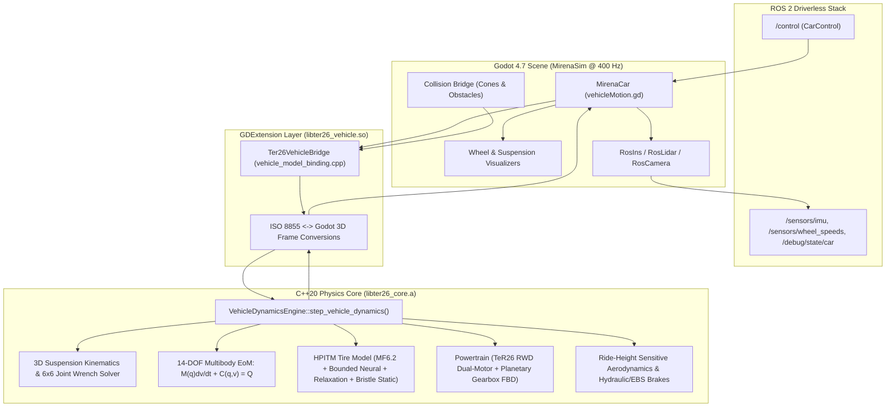

# System Architecture — TeR26 Multibody Vehicle Dynamics Engine

## 1. Architectural Principles

1. **Single Physical Authority:** The C++20 multibody dynamics engine (`ter26::VehicleDynamicsEngine`) is the sole integrator of the 14-DOF mechanical state $q, v$ and internal states $z$ (tire relaxation, thermal, actuator, compliance). Godot 4.7 never integrates chassis or wheel dynamics independently when the native engine is active.
2. **Strict Separation of Physics Core and Godot Adapter:**
   - `Native/include/ter26/` and `Native/src/core/` are 100% independent of Godot headers and types. They compile into a standalone static/shared library (`libter26_core.a`) testable from C++20 unit tests and Python/JAX bindings.
   - `Native/src/godot/` provides the thin GDExtension binding (`Ter26VehicleServer`, `libter26_vehicle.so`) that bridges `Godot::Dictionary`/`PackedFloat64Array`/`Transform3D` to `ter26::VehicleDynamicsEngine`.
   - `vehicleMotion.gd` (`MirenaCar`) and `Godot/*.gd` synchronize the calculated 3D poses and velocities to the Godot scene tree (`MirenaCar`, `$FL_WHEEL`, `$FR_WHEEL`, `$RL_WHEEL`, `$RR_WHEEL`) and sensors (`$INS`, `$Lidar`, `$Camera`, `$MirenaTransform`).
3. **Deterministic Functional Stepping:** Every simulation step is a pure function $(x_{k+1}, y_k, \text{diag}_k) = \mathcal{F}(x_k, u_k, w_k, \theta, \Delta t)$ with zero hidden global mutable state.

---

## 2. Architecture Diagram

---

## 3. Directory Structure

- `Legacy/`: Original `vehicleMotion_legacy.gd` preserved for A/B comparison and instant rollback.
- `Data/`: Centralized JSON engineering database (`TeR26/`, `Tires/`, `Calibration/`, `Schemas/`).
- `Native/`: C++20 core headers (`include/ter26/`), core implementation (`src/core/`), SymPy/SymForce generated C++ kernels (`generated/symforce/`), GDExtension bindings (`src/godot/`), and C++20 unit/numerical/benchmark tests (`tests/`).
- `Godot/`: Modular GDScript adapters (`vehicle_adapter.gd`, `wheel_visualizer.gd`, `suspension_visualizer.gd`, `vehicle_debug_draw.gd`, `vehicle_collision_bridge.gd`).
- `Tools/`: Python 3.12 scientific pipelines (`symforce/`, `tire_fitting/`, `identification/`, `parameter_optimization/`, `validation/`, `visualization/`).
- `Tests/`: Automated test runners and reference fixtures (`unit/`, `numerical/`, `regression/`, `integration/`, `fixtures/`).
- `Docs/`: Complete engineering documentation suite (`architecture/`, `coordinate_systems/`, `equations/`, `interfaces/`, `identification/`, `validation/`).
