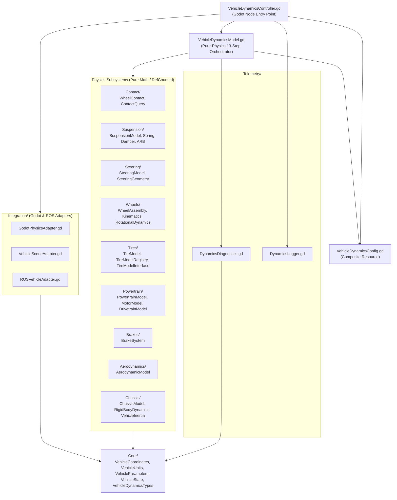
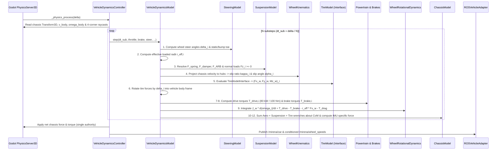

# VehicleDynamics Software Architecture

## 1. Architectural Overview & Design Principles

The `VehicleDynamics` framework replaces the monolithic `vehicleMotion.gd` script (which coupled Godot `VehicleBody3D` raycast-wheel internals, powertrain curves, aerodynamic forces, visual steering meshes, camera cycling, and ROS 2 publishing in a single class) with a strictly layered architecture governed by four principles:

1. **Strict Separation of Physical Concerns**: Each physical domain (Contact, Suspension, Steering, Wheel Kinematics, Tire Force Generation, Powertrain, Brakes, Aerodynamics, Chassis Rigid-Body Wrench Summation) resides in an isolated module with explicit typed inputs and outputs.
2. **Pure-Physics Core vs. Engine/Middleware Adapters**: `VehicleDynamicsModel.gd` and all physics modules (`Core/`, `Chassis/`, `Contact/`, `Suspension/`, `Steering/`, `Wheels/`, `Tires/`, `Powertrain/`, `Brakes/`, `Aerodynamics/`) have **zero dependencies** on the Godot scene tree (`VehicleWheel3D`, `Camera3D`, `NodePath`) or ROS 2 (`RosNode`, `rclgd`). All Godot physics engine I/O, scene visual updates, and ROS 2 communications are confined to `Integration/`.
3. **Immutable Configuration vs. Mutable Runtime State**: Physical parameters live exclusively in `Resource` classes (`*Configuration.gd`, `VehicleParameters.gd`) serialized in `Config/*.tres`. Runtime dynamic variables live in `RefCounted` state containers (`VehicleState`, `WheelState`, `SuspensionState`, `ContactState`, `TireState`, `BrakeState`) with deterministic `.reset()` methods.
4. **Single Force-Application Authority**: To eliminate double-counted tire, gravity, or suspension forces, only `Integration/GodotPhysicsAdapter.gd` applies forces and torques to the chassis `RigidBody3D`.

---

## 2. Module Dependency Graph

Dependencies are strictly acyclic (DAG) flowing downward from `VehicleDynamicsController` through `VehicleDynamicsModel` and `Integration/` to individual domain modules and `Core/`:

---

## 3. Per-Step Data-Flow Pipeline (13-Step Substepped Execution)

Within each Godot `_physics_process(delta)` tick, `VehicleDynamicsController` queries the chassis pose/velocity via `GodotPhysicsAdapter` and ground contact geometry via `ContactQuery`, then executes `N` (default `4`) deterministic substeps of `VehicleDynamicsModel.step(dt_sub, ...)`:

---

## 4. Architectural Decisions & File Organization Notes

All files specified in the target architecture have been created with explicit responsibilities. Rather than leaving empty stubs, every subsystem script implements its complete data contract, coordinate convention, and validation logic:
- **Tire Model Separation**: `Tires/TireModel.gd` manages per-wheel state and first-order transient relaxation lengths ($\sigma_\kappa, \sigma_\alpha$), while delegating steady-state force generation `(F_x, F_y, M_z)` to `Tires/Models/TireModelInterface.gd` resolved through `Tires/TireModelRegistry.gd`. This guarantees that Phase 2 tire implementations (Pacejka MF6.2 from `TeR_Tire/config/pacejka_mf62_params.yaml` or the `TeR_Tire` Physics-Informed Grey-Box residual model) drop in without modifying a single line of `TireModel.gd`, `WheelAssembly.gd`, or `VehicleDynamicsModel.gd`.
